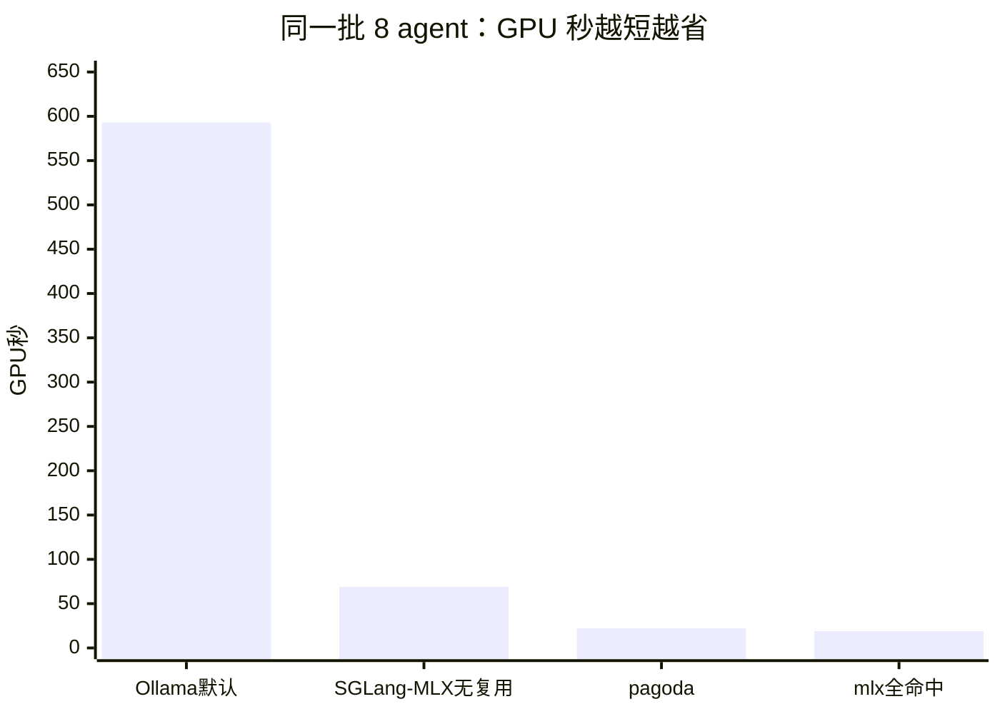

# Agent 集群基准：共享树干 Checkpoint vs 各自 Prefill

测于 2026-10-16。目的不是和 mlx-serve 比单流 tok/s，而是量化 pagoda
**为多 agent 设计的原语**能省多少算力。

## 场景

N 个 agent 共用同一段很长的 system prompt（树干），各自带一句短任务后缀，
各生成 32 个 token（greedy）。

| 路径 | 做法 |
| --- | --- |
| **naive** | 每个 agent 一个全新 `Engine`，完整重放「树干 + 任务」——模拟 N 个互不共享 KV 的 worker |
| **checkpoint** | `create_checkpoint(树干)` 一次，再 `generate_from_checkpoint` × N ——树干只物化一次，分支 100% 前缀命中 |

## 复现

```bash
cd pagoda-hf
cargo run --release --example bench_agent_cluster -- \
  --agents 8 --gen-tokens 32 --trunk-repeats 64
```

后端是离线 toy（`ByteTokenizer` + `NGramModel`），不拉权重、不联网。
树干约 3968 token（`trunk-repeats=64`）。指标看 **model_forwards**（引擎计数的
模型前向次数）和墙钟；toy 模型本身极快，墙钟会被引擎开销放大，**算力省多少
以 forwards 为准**。

## 结果（本机一次运行）

主结果（N = 8）：

| | naive | checkpoint |
| --- | ---: | ---: |
| 墙钟 | 16.9 ms | 1.2 ms |
| model_forwards | 32 368 | 624 |
| 产出 token | 256 | 256 |
| 前缀命中合计 | 0 | 31 744（每分支 3968 = 整棵树干） |

| 加速 | |
| --- | ---: |
| 墙钟 | **14.6×** |
| model_forwards | **51.9×** |
| forwards 节省比例 | **98%** |

Agent 数扫描（同一树干、每分支 32 token）：

| N | 墙钟加速 | forwards 加速 | naive forwards | ckpt forwards |
| ---: | ---: | ---: | ---: | ---: |
| 2 | 8.6× | 51.9× | 8 092 | 156 |
| 4 | 12.1× | 51.9× | 16 184 | 312 |
| 8 | 14.3× | 51.9× | 32 368 | 624 |
| 16 | 16.9× | 51.4× | 64 748 | 1 260 |

墙钟随 N 升高接近线性改善；forwards 加速接近「树干 / 每分支续写」量级
（~3968 / ~78 ≈ 51），与理论一致：naive 付 N 次树干，checkpoint 只付 1 次。

## 和单流 tok/s 的关系

同机 Qwen3.8-27B-8bit Metal 单流热解码约 18 tok/s，mlx-serve 约 23.5。
那条曲线衡量的是 **GEMV 带宽**；本基准衡量的是 **多分支是否重复付树干
prefill**。agent 集群的钱烧在共享 system prompt 上时，pagoda 的 checkpoint
路径省的是后者——在本测里省掉了约 98% 的模型前向。

真权重路径（`--gguf` / `--repo`）可在 Hub 可达时接上同一套对比；场景定义不变。

## 相对 mlx-serve / Ollama 能量化多少

三者都是**自建推理**时，账单近似跟 **GPU 时间**走，不是跟「产出 token 标价」走。
共享树干场景下，省的是 **重复 prefill**，可用同一套会计式估算（与后端 tok/s 无关的是「算力 token」比例；换成墙钟要再除以各家速度）。

### 竞品横比（同一份活谁更省）

同一场景：**8 agent × ~4000 token 系统提示 × 各生成 32 token**。比的是跑完这一批要多少 GPU 秒（越短越省）。

| 产品 / 路径 | GPU 秒（估） | 相对 Ollama 默认 | 相对 mlx 无复用 |
| --- | ---: | ---: | ---: |
| **Ollama 默认**（每人重算系统提示） | 593 | 基线 | — |
| **SGLang Mac + MLX**（无跨请求 KV；≈ mlx 无复用） | ~69 | 省 88% | 基线同档 |
| **mlx-serve**（无前缀复用） | 69 | 省 88% | 基线 |
| **pagoda checkpoint** | 22 | **省 96%** | **省 68%** |
| mlx-serve（prefix cache 全命中） | 19 | 省 97% | 省 72% |



读法：

1. **对 Ollama**：pagoda 大约省 **96%** GPU 时间（默认不共享树干时）。
2. **对 mlx / SGLang-Mac-MLX 无复用**：大约省 **68%**（Mac 上 SGLang 的 MLX 后端目前未接 radix，多请求≈每人付满树干）。
3. **对 mlx 全命中**：秒数接近（22 vs 19）；差别是 pagoda **钉住 + fork 契约**，mlx 靠缓存碰巧命中。
4. **单人聊天速度**仍是 mlx / SGLang-MLX 更快（~23.5 vs ~18 tok/s）——和这张「集群总账」不是同一题。

说明：Ollama 用公开 8B 速率示意，mlx/pagoda 用本机 27B 速率估算；SGLang Mac 行按「解码≈mlx、无跨请求前缀」与 mlx 无复用同档（见 `BENCHMARK-METAL.md`）；跨模型不能当绝对跑分，看的是「有没有重复付系统提示」。

### 会计式

符号：`T` = 树干 token，`S` = 每分支后缀，`G` = 每分支产出，`N` = 分支数。

| | 提示侧要算的 token | 解码 token |
| --- | ---: | ---: |
| 无共享（N 次完整请求） | `N × (T + S)` | `N × G` |
| checkpoint / 完美前缀命中 | `T + N × S` | `N × G` |

提示侧节省比例：

```text
eta = (N - 1) × T  /  (N × (T + S))
```

本基准 `T = 3968`，`S ≈ 50`，`N = 8` → **eta ≈ 86%**（只看提示）；
把解码也算进「模型前向」后，实测 forwards 节省 **98%**（树干远长于续写时，两者接近）。

### 对照假设（公平边界）

| 对手 | 默认行为 | 和 pagoda checkpoint 比 |
| --- | --- | --- |
| **Ollama**（多请求、无跨请求 KV 契约） | 每个 agent 一次完整 prompt | 提示算力按上表 eta 近似；本测级 **~86–98%** |
| **mlx-serve**（开了 prefix cache） | 相同前缀二次请求可命中 | **冷的第一趟**仍要付满 `T`；第 2…N 趟若前缀仍在 cache 里，提示节省可接近 pagoda；**不保证**不被 LRU 挤掉，也没有「钉住树干再 fork」的契约 |
| **SGLang Python（Mac + MLX）** | 单流走 mlx-lm；**跨请求 radix 未接通** | 集群总账≈「mlx 无复用」；单流 tok/s 仍高于 pagoda |
| **SGLang Python（CUDA）** | 有 radix / 连续批 | Mac 上不可用；那是另一台机器的主场 |
| **单流 tok/s** | mlx/SGLang-MLX ~23.5、pagoda 27B Metal ~18 | 只比解码带宽；**不代表** agent 集群总账 |

结论：相对「Ollama / Mac 上 SGLang-MLX 式 N 次独立完整请求」，降本比例由 eta 锁死，**与用哪家引擎无关**——pagoda 把这条路径做成一等原语并测到 98% forwards。相对已开 prefix cache 的 mlx-serve，稳态提示节省同阶，差异在 **命中保证 / 分支 fork / 不被淘汰**，不是再挖出一个数量级的 GEMV。

### 换成 GPU 时间与公开单价（Ollama 生态）

公开数据（SaladCloud 上 Ollama + Llama 3.1 8B，多副本压测，
[r/LocalLLaMA 汇总](https://www.reddit.com/r/LocalLLaMA/comments/1hbdczu/llama_31_8b_benchmark_on_9_different_rtx_gpus/)）：
RTX 3090 节点约 **$0.14/小时**，集群峰值约 **1706 产出 tok/s**，折合约 **$0.228 / 百万产出 token**。

注意：按「产出 token」计费时，naive 与 checkpoint **产出相同**，这张价目表**看不出** prefill 节省。要把降本说清楚，应改算 **GPU 秒**：

```text
t_naive ≈ N×(T+S) / r_prefill  +  N×G / r_decode
t_share ≈ (T + N×S) / r_prefill  +  N×G / r_decode
```

用公开量级作示意（非本机实测）：Ollama Llama 3.1 8B 在 Apple 硅上 gen 约 **47–57 tok/s**（[ollama#8643](https://github.com/ollama/ollama/pull/8643) warm），
prompt eval 同 PR 约 **50–60 prompt tok/s** 量级；取 `r_prefill = 55`、`r_decode = 50`，`T = 4000`，`S = 50`，`G = 32`，`N = 8`：

| | GPU 秒（估） | 相对 |
| --- | ---: | ---: |
| N 次完整请求 | `8×4050/55 + 256/50 ≈ 593` | 1.0× |
| 完美树干共享 | `4400/55 + 256/50 ≈ 85` | **~7.0× 更短**（GPU 时间省 **~86%**） |

若节点 **$0.14/小时 ≈ $3.9e-5 / 秒**：该场景一笔从约 **$0.023** 降到约 **$0.003**（仅示意量级；真实 prefill 速率随长度/量化会变）。

### 本机 mlx-serve（27B）同一公式

本机 mlx-serve Qwen3.8-27B-8bit：解码 **~23.5 tok/s**；长提示冷 TTFT 1.47 s / 827 token → prefill 约 **~560 tok/s** 量级（`BENCHMARK-METAL.md`）。同一 `T, S, G, N`：

| | GPU 秒（估） |
| --- | ---: |
| N 次完整（无前缀复用） | `32400/560 + 256/23.5 ≈ 69` |
| 完美树干共享 | `4400/560 + 256/23.5 ≈ 19` |
| **GPU 时间节省** | **~72%** |

pagoda 同机 27B 解码 ~18 tok/s 时，共享树干后总墙钟仍可能接近或略慢于「mlx + 稳定 prefix hit」；**确定能报的降本数字是提示算力 eta 与 forwards 节省**，不是「单流一定比 mlx 便宜」。

### 一句话

- **vs Ollama（独立完整请求）**：提示算力可省 `(N-1)×T / (N×(T+S))`；本测参数约 **86%**，含解码的 forwards 实测 **98%**；GPU 时间同阶。
- **vs SGLang Python on Mac（MLX）**：单流≈mlx（~23.5 > pagoda ~18）；多 agent 因 Mac-MLX **尚无 radix**，总账≈无复用，pagoda checkpoint 仍可报同档 GPU 秒节省。
- **vs mlx-serve（有 prefix cache）**：稳态可省同阶 prefill，但 pagoda 多的是 **checkpoint 钉住 + fork 契约**；单流带宽仍是 mlx 更快。
- **不要用「$/百万产出 token」直接比**——产出一样，那张价看不出树干复用。
